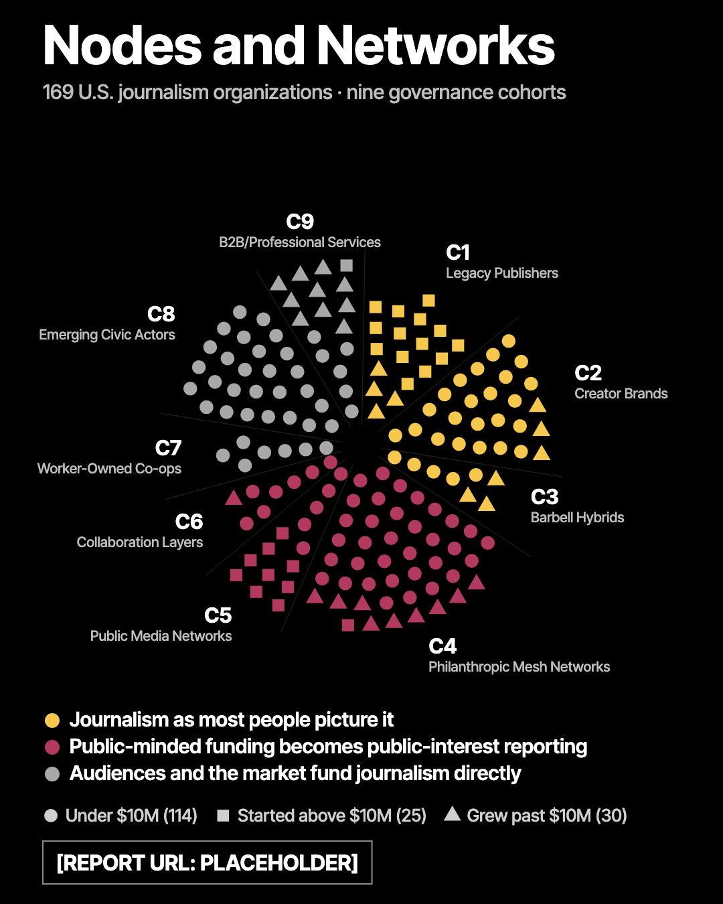

# Embedding the Nodes and Networks explorer

Replace `{{EXPLORER_URL}}` with the final address once the report URL is set. Until then the preview address is
`https://journalismatlas.com/preview/nn-launch-kit/explorer/`.
Every example uses `?embed=1`, which removes the page header and footer, makes the background transparent and reports its height to the host page.

## 1. Plain iframe (works with no scripts)

Fixed height **1650 px** at every width. Content is never taller than about 1610 px in any tab at any iframe width from 310 px to 760 px (the iframe is never wider than 760 px). The explorer switches to its embed layout when the URL has `?embed=1` or when it is framed from another site; it then uses Arial, a transparent background, and a compact layout on narrow screens. The dark chart panels end where the content ends, so any spare height shows the host page, not a black block.

```html
<iframe
  src="https://journalismatlas.com/preview/nn-launch-kit/explorer/?embed=1&tab=ways"
  title="Nodes and Networks explorer: 169 U.S. journalism organizations"
  loading="lazy"
  style="display:block;width:100%;max-width:760px;height:1650px;margin:0 auto;border:0"></iframe>
```

Use `{{EXPLORER_URL}}` in place of the address once the final one is set. In embed mode the explorer always uses its light-page text colors on a transparent background, whatever the visitor's dark-mode setting, so it reads on a white host page.

In a CMS draft preview on a host other than cronkite.asu.edu the iframe may show blank, because the explorer's server only allows framing from asu.edu and journalismatlas.com. It works once the page is published on cronkite.asu.edu.

## 2. Optional: trim the height

Optional — trims height if your CMS allows scripts. Add this after the iframe; without it the iframe simply keeps its fixed 1650 px. The explorer posts `{source:'nn-explorer', type:'height', height:<px>}` whenever its size changes.

```html
<iframe id="nn-explorer" src="https://journalismatlas.com/preview/nn-launch-kit/explorer/?embed=1&tab=ways"
  title="Nodes and Networks explorer" loading="lazy"
  style="display:block;width:100%;max-width:760px;height:1650px;margin:0 auto;border:0"></iframe>
<script>
/* optional — trims height if your CMS allows scripts */
addEventListener('message', function (e) {
  var d = e.data, f = document.getElementById('nn-explorer');
  if (!d || d.source !== 'nn-explorer' || d.type !== 'height' || e.source !== f.contentWindow) return;
  f.style.height = d.height + 'px';
});
</script>
```

The `e.source` check accepts messages only from this frame; a message posted by any other window is ignored. Use a second copy with a different `id` for a second explorer on the same page.

## 3. Fallback (CMS strips iframes)

A still image of the governance tab, linked to the live explorer. File: `nodes-networks-governance-4x5-still.png` (1080 × 1350, upload it to the CMS media library).

```html
<a href="{{EXPLORER_URL}}?tab=governance">
  
</a>
```

## 4. Deep links

Add `&embed=1` to any of these when embedding.

| View | Link |
|---|---|
| Governance (default) | `{{EXPLORER_URL}}?tab=governance` |
| The 6 ways | `{{EXPLORER_URL}}?tab=ways` |
| History | `{{EXPLORER_URL}}?tab=history` |

## Notes for ASU

- Tabs are keyboard reachable (arrow keys move between them) and the explorer follows the visitor's light or dark setting. The chart stage is always black.
- With "reduce motion" on, tabs switch instantly with no animation.
- Hover or tap a mark for a card. The card shows the organization's name, cohort, mechanism (or "Started above $10M" / "No mechanism"), revenue bracket and year founded. Organization names are shown: Justin and Carrie decided on the Oct 28 call to publish with names, which settles the earlier open decision.
- No cookies, no network requests, no external fonts or scripts: the page is one self-contained file.
- Open questions for ASU: whether iframes are allowed, whether scripts are allowed, and the maximum content width. These decide which snippet to use.
